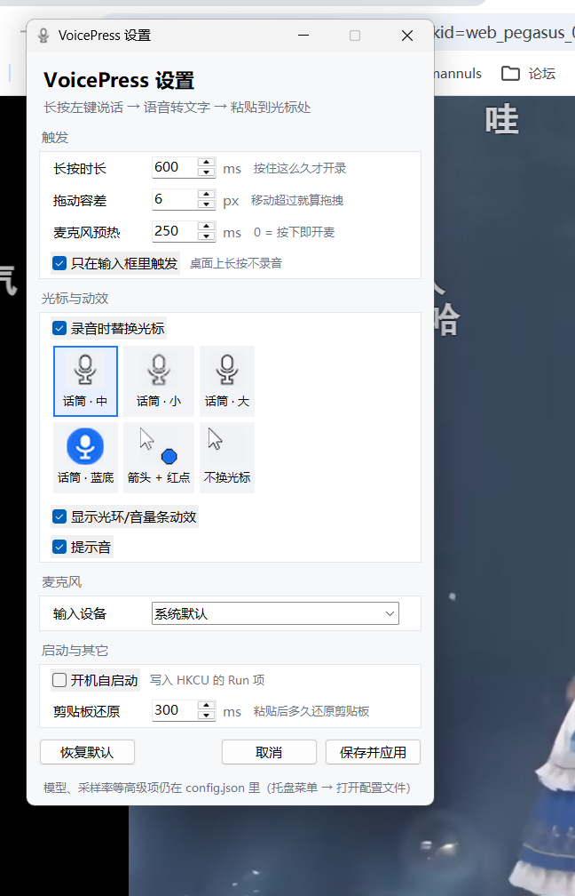
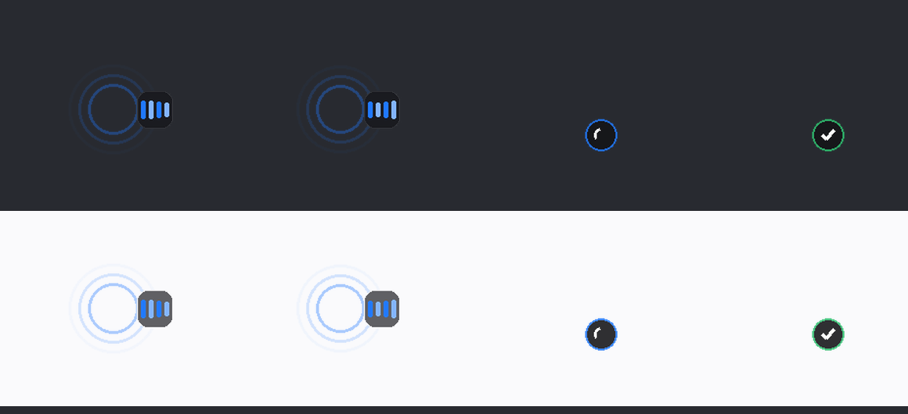
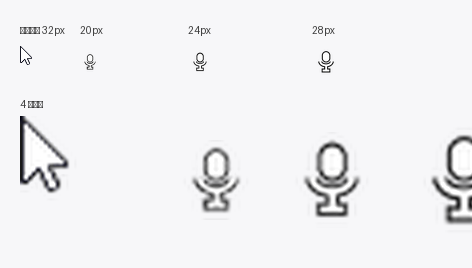

# VoicePress — 长按左键说话，自动变成文字

按住鼠标左键不动 → 说一句话 → 松开 → 文字自动出现在当前光标所在的输入框里。

纯本地运行：语音识别用 faster-whisper（GPU 时 large-v3，CPU 时 small），音频不上传。



---

## 下载哪个

从 [Releases](https://github.com/zwx-zwx/voicepress/releases) 下载：

| 产物 | 体积 | 适合谁 |
| --- | --- | --- |
| `VoicePress.exe` | ~130 MB | 图省事。双击即用，**首次运行会下载模型**（有显卡约 3.1GB，没有约 480MB），之后不再需要联网 |
| `VoicePress-offline.zip` | ~580 MB | 要"下载完就能用、不联网"的场合。解压即用，内置 small 模型，CPU 跑 |

两个都是免安装的，不需要 Python。exe 没有代码签名，Windows SmartScreen 会提示"未知发布者"，点"更多信息 → 仍要运行"即可。

**数据（模型、配置、日志）不放在程序目录**，也不占系统盘：首次运行会自动挑一个可用空间最大的非系统盘，建 `<盘符>:\VoicePress`。想指定位置就设环境变量 `VPR_DATA_DIR`：

```bat
set VPR_DATA_DIR=D:\我的工具\VoicePress
VoicePress.exe
```

---

## 启动

| 方式 | 说明 |
| --- | --- |
| 双击 `start.cmd` | 正常启动（托盘常驻，无控制台窗口） |
| 双击 `start-admin.cmd` | 以管理员身份启动，只有这样才能往"以管理员运行的程序"里粘贴 |
| `pythonw voicepress.py` | 同上，直接命令行启动 |

启动后任务栏出现一个蓝色话筒图标，右键菜单：**设置…**（默认项，双击图标也能开）、暂停/恢复、只在输入框触发、打开配置文件、打开日志、退出。

第一次启动会加载模型，约 3~5 秒；之后每次转写只要 0.5 秒左右（5 秒语音）。

## 设置面板

托盘右键 → **设置…**（或 `python voicepress.py --settings`），一个独立窗口：

- **触发**：长按时长、拖动容差、麦克风预热、只在输入框里触发
- **光标与动效**：录音时替换光标（6 种图标可选，带缩略图预览）、光环/音量条动效、提示音
- **麦克风**：输入设备下拉（自动列出本机所有输入设备）
- **启动与其它**：开机自启动、剪贴板还原延迟

点"保存并应用"后写回 `config.json`，主程序 1~2 秒内**自动热加载**，不用重启。
面板是独立进程（`pythonw settings.py`），所以不会和托盘/录音线程抢 Tk 主循环。

图标可选：话筒·中/小/大、话筒·蓝底、箭头+红点（保持原光标只挂一个小蓝点）、不换光标。


## 从零安装（换机器 / 重新克隆）

仓库里不放模型和依赖（合起来 3GB+，全在 .gitignore 里），克隆后补齐这两步：

```bat
git clone https://github.com/zwx-zwx/voicepress.git
cd voicepress

:: 1) 依赖装在项目内的 libs/，不污染系统 Python
python -m pip install --target libs faster-whisper sounddevice pynput pyperclip pystray pillow uiautomation

:: 2) 模型（走 ModelScope，约 3.1GB）
python fetch_model.py

:: 3) 启动（首次会自动生成 config.json）
start.cmd
```

环境要求：Python 3.10+；有 NVIDIA 显卡会走 CUDA fp16（需要 CUDA 12 + cuDNN 9，装 torch 会自带），没有则自动回退 CPU/int8，速度慢一些但能跑。

## 怎么用

1. 光标点进任意输入框（浏览器地址栏、聊天框、记事本、IDE 编辑器……）
2. **按住鼠标左键 0.6 秒不动**，听到"叮"一声
3. 说话
4. 松开左键 → 再"叮咚"两声 → 文字粘贴进去

三个提示音的含义：单声 = 开始录音，两声 = 成功粘贴，低音 = 取消/出错。

**视觉反馈**（可以关，见配置）：

- 开始录音时，鼠标光标会变成一支**话筒**（白色话筒 + 黑描边，24px 画布，比系统箭头小一号）
- 光标周围会出现**脉冲光环**，右侧跟着**音量条**随你说话跳动——能直观看到麦克风真的在收音
- 松开后：转写中转圈 → 成功打绿勾 → 0.7 秒后自动消失；没听清/出错是红叉
- 动效层是"鼠标穿透 + 不抢焦点"的分层窗口，不会挡住点击，也不会把 Ctrl+V 抢走



光标有 6 套可选（话筒三档大小、蓝色圆底、箭头+红点、不换光标），设置面板里点缩略图即可切换：



**不会误触发**：按下后鼠标移动超过 6 像素就判定为拖拽/选区，直接放弃，所以正常拖文件、选文字、拖窗口都不受影响。

## 配置

常用项在设置面板里改；面板没覆盖的项可以直接改 `config.json`，保存后 1~2 秒自动热加载（不用重启）。

| 键 | 默认 | 说明 |
| --- | --- | --- |
| `hold_ms` | 600 | 按住多久算说话。嫌容易误触就调大到 800 |
| `move_tolerance_px` | 6 | 超过这个位移就当拖拽。手抖的话调大到 10~15 |
| `only_in_text_field` | true | 只在可编辑控件上触发（UI Automation 判断）。关掉则任何地方长按都录音 |
| `prebuffer_ms` | 250 | 按住这么久后先开麦预热，避免开头丢字。设 0 会每次点鼠标都开麦（图标闪） |
| `input_device` | 无 | 麦克风名字片段或设备序号，留空用系统默认。当前默认是"麦克风 (罗技高清网络摄像机 C930c)" |
| `model` | large-v3 | 会自动使用 `models/large-v3/` 里的本地模型 |
| `device` / `compute_type` | cuda / float16 | 显卡跑不动会自动回退 CPU/int8 |
| `beam_size` | 5 | 5 更准，1 更快 |
| `initial_prompt` | … | 引导模型输出简体中文带标点，可按自己说话习惯改 |
| `beep` | true | 提示音 |
| `overlay` | true | 光标旁边的光环/音量条/转圈/对勾动效 |
| `cursor_icon` | true | 录音时把光标换成话筒。嫌别扭可以设 false，只留动效 |
| `cursor_preset` | mic24 | 用哪支光标：`mic24` / `mic20` / `mic28` / `mic_disc` / `badge` / `arrow`（不换） |
| `paste_restore_delay_ms` | 300 | 粘贴后多久还原剪贴板。某些慢的应用可以调大到 500 |

粘贴走的是"写剪贴板 + 发 Ctrl+V"，结束后会把原来的剪贴板内容还原回去。

## 自测命令

```bat
python voicepress.py --devices                       :: 列出麦克风
python voicepress.py --focus                         :: 打印当前焦点控件（调试触发范围）
python voicepress.py --transcribe test_zh.wav        :: 只测转写
python voicepress.py --paste "测试一下"              :: 3 秒内点目标输入框，测粘贴
python e2e_test.py                                   :: 全链路自测（弹窗、外放、模拟长按）
```

## 已知限制

- **光标图标**：Windows 只能整张替换系统光标表（箭头 / I 型 / 手型 / 十字四种一起换），所以长按期间这些光标都会变成话筒，松手立刻还原。程序启动和退出时也会强制还原一次，避免上次被强杀后光标停在话筒上。不喜欢就把 `cursor_icon` 设成 false。
- **图标大小不合口味**：`python make_assets.py --size 20 --compare` 重新生成（默认 24，可选 20/24/28），`--compare` 会输出和系统箭头的对比图；改完重启程序生效。
- **光标卡在话筒上**：`python voicepress.py --restore-cursor` 让 Windows 重载整套光标方案，立刻恢复（程序正常退出时也会自动做这一步）。
- **总开关**：`overlay: false` + `cursor_icon: false` 就退化成纯提示音版本。

- **管理员窗口**：Windows 的安全机制不允许普通进程往高权限窗口注入按键。要覆盖这类窗口，用 `start-admin.cmd` 启动。
- **长按本身就是一种输入行为**：在某些程序里长按左键有别的含义（比如某些游戏、绘图软件），同时开两份会互相打架。这种情况建议用托盘菜单临时暂停。
- **空语音/闭嘴**：录音里没人说话时会安静地什么都不做（不会粘一个空字符串）。
- **显存**：large-v3 fp16 常驻约 3GB 显存，首次加载后一直占着（为了第一次用就快）。
- **开机自启**：在设置面板勾选即可（写 `HKCU\Software\Microsoft\Windows\CurrentVersion\Run`）。需要管理员权限启动的话，改用 `shell:startup` 里的 `start-admin.cmd` 快捷方式。

## 目录

```
voicepress/
├─ voicepress.py      主程序（鼠标钩子 / 录音 / 转写 / 粘贴 / 托盘 / 热加载）
├─ main.py            打包入口（PyInstaller 用）
├─ paths.py           路径：只读资源 vs 可写数据（数据默认放非系统盘）
├─ bootstrap.py       首次运行向导（探测显卡、下载模型）
├─ settings.py        设置面板（独立进程运行）
├─ autostart.py       开机自启（注册表 Run 项）
├─ overlay.py         光标旁的光环/音量条/转圈/对勾（分层窗口）
├─ syscursor.py       系统光标替换与还原
├─ make_assets.py     光标图标库生成
├─ build.py           打包脚本（瘦 exe / 离线包）
├─ voicepress.spec    PyInstaller 配置
├─ config.example.json 配置样例（真正的 config.json 不进仓库）
├─ start.cmd          源码模式启动
├─ start-admin.cmd    管理员权限启动
├─ assets/cursors/    6 套光标（.cur + 缩略图）
├─ e2e_test.py        端到端自测
├─ fetch_model.py     模型下载脚本（走 ModelScope，hf.co 直连不通）
├─ models/large-v3/   本地模型（约 3.1GB，不进仓库）
├─ libs/              依赖（不进仓库）
└─ voicepress.log     运行日志
```

## 实现要点

- 鼠标钩子用 pynput 的全局 Listener，不阻塞系统事件。
- 音频用 sounddevice，统一重采样到 16k 单声道。
- 焦点判断用 UI Automation（单线程 + 3 秒结果缓存）：EditControl / DocumentControl 才算输入框；UIA 卡住不影响录音流程。
- 转写串行排队，避免连说两句时显卡抢资源。
- 单实例互斥锁，防止开两份导致录两遍。

## License

[MIT](LICENSE) © 2026 ZVVVVX
